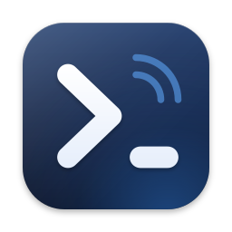
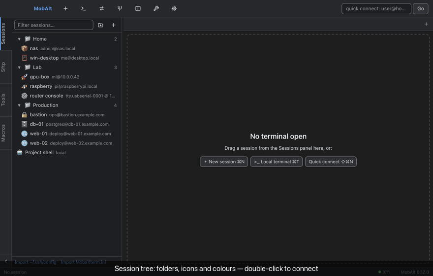

<p align="center">
  
</p>

<h1 align="center">MobAlt</h1>

<p align="center"><strong>macOS용 MobaXterm 스타일 SSH / SFTP / 터미널 작업대.</strong></p>

<p align="center">
  <a href="https://github.com/Hyeongcheol-An/MobAlt/releases"></a>
  <a href="https://github.com/Hyeongcheol-An/MobAlt/actions/workflows/release.yml"></a>
  <a href="LICENSE"></a>
</p>

<p align="center"><a href="README.md">English README</a> · <a href="docs/USER_GUIDE.ko.md">사용자 안내서</a></p>


Windows에서 MobaXterm을 쓰던 방식 그대로 Mac에서 일할 수 있도록 만든 앱입니다. 세션 트리, 탭·분할
터미널, SSH 접속과 함께 열리는 SFTP 브라우저, 포트 포워딩, MultiExec, X11 포워딩, 매크로, 네트워크
도구, 시리얼 콘솔을 한 창에 담았습니다. xterm.js, ssh2, node-pty 기반의 Electron 앱입니다.

## 데모



35초 둘러보기: 세션 트리, 원격 셸, 파일 브라우저, MultiExec로 두 페인에 동시에 입력하는 분할 탭, 페인 확대, 테마
전환입니다(가상의 호스트이며 `npm run demo`로 다시 만들 수 있습니다).

## 기능

| MobaXterm | MobAlt | 비고 |
|---|---|---|
| Sessions 사이드바 (폴더, 검색) | ✅ Sessions 패널 | 중첩 폴더, 드래그 이동, 필터, 우클릭 메뉴, 복제 |
| SSH (비밀번호/키/에이전트) | ✅ | 키 → 에이전트 → 비밀번호 자동 순서, keyboard-interactive(2FA), 패스프레이즈 프롬프트, `~/.ssh/config`·ProxyJump |
| 비밀번호 저장(마스터 암호) | ✅ | Electron `safeStorage`(macOS Keychain)로 암호화 |
| Host key 확인 | ✅ | `~/.ssh/known_hosts` + 앱 자체 목록, 키 변경 시 경고 |
| 접속 시 SFTP 브라우저 | ✅ Sftp 패널 | 업로드/다운로드(폴더 재귀, 진행률, 취소), 새 폴더, 이름 변경, 권한, 삭제, 숨김 파일 |
| Follow terminal folder | ✅ | bash/zsh용 OSC 7 셸 훅, 세션별 설정 |
| 원격 파일 편집 | ✅ | 내장 편집기(⌘S 저장) 또는 외부 편집기(저장 시 자동 업로드) |
| 드래그 앤 드롭 업로드 | ✅ | Finder 항목을 SFTP 목록이나 터미널에 드롭 |
| 내장 X 서버 | ✅ XQuartz 연동 | 필요할 때 XQuartz를 띄우고 X11 채널을 쿠키 교체 프록시로 중계 |
| MobaSSHTunnel | ✅ Tunneling | Local(-L), Remote(-R), Dynamic SOCKS5(-D). 세션별 자동 시작 또는 독립 터널 |
| MultiExec | ✅ | 모든 터미널에 동시 입력 (⇧⌘M) |
| 분할 터미널 | ✅ | 오른쪽/아래 분할과 최대 2×4(8개) 격자. 빈 페인이나 페인 가장자리에 세션 드롭, 탭을 페인으로 드래그 |
| Macros | ✅ | 키 입력 녹화/재생, 텍스트 매크로, 모든 터미널에 재생 |
| Tools | ✅ Tools 패널 | Ping, Traceroute, DNS 조회, 포트 스캔, 네트워크 정보 |
| Telnet | ✅ | NAWS/TTYPE 협상 |
| Serial 콘솔 | ✅ | USB-시리얼 자동 검색, baud/framing/flow, 로컬 에코, CR/LF/CRLF |
| 로컬 터미널 | ✅ | 로그인 셸(zsh/bash) 그대로, 폴더 추종 통합 |
| 세션 로그 | ✅ | 세션 설정 또는 탭 메뉴 |
| RDP / VNC | ⚠️ 외부 앱 | RDP는 `.rdp` 파일을 만들어 Windows App으로, VNC는 macOS 화면 공유로 |
| MobaXterm.ini 가져오기 | ✅ | Bookmarks 섹션 best-effort 파싱, `~/.ssh/config` 가져오기 |
| 세션 내보내기 / 가져오기 | ✅ | 모든 세션과 폴더를 JSON 파일로(비밀번호·키 암호는 절대 포함하지 않음). Session 메뉴 또는 트리 우클릭 메뉴. 가져올 때 같은 id는 교체하고 나머지는 추가 |
| 분할 페인 최대화 | ✅ Zoom | ⇧⌘⏎(또는 페인 머리글의 ⤢)로 포커스된 페인이 탭을 가득 채우고 다시 되돌림. 탭마다 기억하며 재시작 후에도 유지 |
| 색상 테마 / 다크 모드 | ✅ | Moba Dark, One Dark, Dracula, Solarized Dark, Gruvbox Dark, Light가 터미널만이 아니라 창 전체(툴바·사이드바·탭·대화상자)에 적용. 세션별로 터미널 테마만 덮어쓰기 가능 |
| Mosh | ✅ | mosh 클라이언트를 페인에서 실행(`brew install mosh` 필요), 키 또는 대화형 프롬프트로 ssh 부트스트랩, 동반 SSH 연결로 SFTP |
| FTP / FTPS | ✅ | 명시적 TLS FTPS, 익명 FTP. Sftp 패널에서 탐색·전송·편집 |

MobaXterm 26.6과의 기능별 전체 비교: [docs/MOBAXTERM_PARITY.ko.md](docs/MOBAXTERM_PARITY.ko.md).

작업대 복원 기능이 탭·분할·세션(로컬 셸은 폴더까지, 확대한 페인은 확대 상태까지)을 다음 실행 때 되살리고 SSH는 자동 재접속합니다. 시작 시
GitHub Releases에서 새 버전을 확인하며(Settings → Updates, Help → Check for Updates…) 동의할 때만 설치합니다.

<table>
<tr>
<td></td>
<td></td>
</tr>
<tr>
<td></td>
<td></td>
</tr>
</table>

## 설치

**요구 사항**: macOS 13 Ventura 이상, Apple Silicon 또는 Intel. 선택: X11 포워딩용
[XQuartz](https://www.xquartz.org/), RDP용 [Windows App](https://apps.apple.com/app/windows-app/id1295203466).

### Homebrew

```bash
brew tap Hyeongcheol-An/tap
brew trust Hyeongcheol-An/tap      # Homebrew 7부터 외부 tap은 한 번 신뢰 처리가 필요합니다
brew install --cask mobalt
```

이후 업데이트는 `brew upgrade --cask mobalt`. cask 파일은 이 저장소에도 있습니다(`Casks/mobalt.rb`).

**업데이트**: 앱 내 업데이트, `brew upgrade --cask mobalt`, 새 DMG 모두 MobAlt가 실행 중이어도 되며, 앱이
재시작 배너를 띄웁니다. 사용자 안내서의 [업데이트](docs/USER_GUIDE.ko.md#업데이트)를 보세요.

### DMG

1. [Releases](https://github.com/Hyeongcheol-An/MobAlt/releases)에서 `MobAlt-<버전>-arm64.dmg`(Apple Silicon)
   또는 `MobAlt-<버전>-x64.dmg`(Intel)를 받습니다.
2. 열어서 **MobAlt**를 **Applications**로 끌어다 놓습니다.

릴리스 빌드는 Developer ID 인증서로 서명하고 Apple 공증을 받으므로 Gatekeeper 경고 없이 열립니다.
직접 빌드한 앱은 첫 실행 때 우클릭 → **열기**를 쓰거나 `xattr -dr com.apple.quarantine /Applications/MobAlt.app`으로
격리 속성을 지우세요.

## 사용법

자세한 내용은 [사용자 안내서](docs/USER_GUIDE.ko.md)에 있고, 요약은 다음과 같습니다.

- **세션**: `＋ Session`(⌘N) → SSH / Mosh / Local / Telnet / Serial / FTP / RDP / VNC 선택 → 저장 & 접속. 사이드바에서
  더블클릭으로 접속하고, 세션은 폴더로, 폴더는 다른 폴더로 드래그해 정리합니다.
- **빠른 접속**: 툴바 입력란에 `user@host[:port]`를 넣고 Enter. `mosh://`, `telnet://`, `ftp://`, `ftps://`, `rdp://`,
  `vnc://` 접두사도 됩니다.
- **SFTP**: SSH 세션에서 자동으로 열립니다. 더블클릭으로 이동·편집, `>_` 버튼으로 터미널에 `cd` 전송,
  세션 옵션으로 터미널 폴더 추종.
- **터널**: `Tunneling`(⇧⌘U)에서 열린 연결 또는 저장된 세션으로 터널을 시작합니다. 세션 편집기 Tunnels 탭에
  등록한 터널은 접속과 함께 시작됩니다.
- **분할**: `Split ▾`로 오른쪽/아래 빈 페인 또는 격자(최대 2열×4줄)를 만듭니다. 사이드바의 세션을 빈 페인에
  놓으면 그 자리에 접속, 페인 가장자리에 놓으면 그 방향으로 분할, 가운데에 놓으면 교체. 탭을 페인에 끌면
  그 터미널이 이동합니다. 폴더 우클릭 메뉴로 폴더 전체를 격자로 열 수 있습니다.
  ⇧⌘⏎는 포커스된 페인을 탭 전체로 확대했다가 되돌립니다.
- **아이콘·색상**: 세션 편집기에서 이모지와 색을 고르면 사이드바·탭·페인 머리글에 표시됩니다.
- **시작 명령**(MobaXterm의 *Execute command*): 세션 편집기 Terminal 탭의 Startup commands는 터미널이 준비되면
  모든 세션 종류에서 자동 입력됩니다. 예: 로컬 세션의 Start folder를 프로젝트 폴더로, 시작 명령을
  `claude --resume <id>`로 두면 열 때마다 Claude Code가 이어집니다.
- **MultiExec**: 툴바 버튼 또는 ⇧⌘M. 켜져 있는 동안 입력이 모든 터미널로 갑니다.
- **키보드**: Help → Keyboard Shortcuts. 우클릭은 붙여넣기(⇧+우클릭은 메뉴), 선택하면 복사됩니다.
  Shift+Enter와 Option+Enter는 ESC+CR을 보내 Claude Code 같은 TUI에서 줄바꿈으로 동작합니다.

## 데이터와 개인정보

모든 데이터는 `~/Library/Application Support/MobAlt/`에 있습니다: `sessions.json`(비밀번호·패스프레이즈는
macOS Keychain 기반 암호화), `settings.json`, `known_hosts`, `workspace.json`. 세션 로그 기본 위치는
`~/Documents/MobAlt Logs/`입니다. 앱은 사용자가 설정한 호스트에만 접속하며 텔레메트리가 없습니다. 선택적인 업데이트 확인은 GitHub의
릴리스 목록만 읽습니다. 자세한 내용은 [SECURITY.md](SECURITY.md)에 있습니다.

## 개발

요구 사항: Node.js 22+, Xcode Command Line Tools(`node-pty` 빌드). 아이콘·DMG 배경을 다시 생성할 때(`npm run assets`)는
librsvg와 ImageMagick도 필요합니다: `brew install librsvg imagemagick`.

```bash
git clone https://github.com/Hyeongcheol-An/MobAlt.git
cd MobAlt
npm install            # node-pty를 Electron용으로 리빌드
npm start              # 소스에서 실행
npm test               # 단위 테스트
npm run pack           # dist/mac-arm64/MobAlt.app (서명 없음)
npm run dist           # arm64·x64 DMG + zip
npm run install:local  # arm64 빌드, Developer ID 인증서가 있으면 서명, /Applications에 설치
```

`ELECTRON_RUN_AS_NODE=1`이 설정된 셸(VS Code 통합 터미널)에서는 `env -u ELECTRON_RUN_AS_NODE npm start`로
실행하세요. 소스 구조와 E2E 테스트 방법은 [영문 README](README.md#development)를 참고하세요.

## 릴리스

커밋은 [Conventional Commits](https://www.conventionalcommits.org/)를 따릅니다(`feat:` → minor, `fix:` → patch,
`feat!:` → major). `main`에 push되면 `.github/workflows/release.yml`이 gitleaks 비밀 검사 → 단위 테스트 →
`semantic-release`를 실행해 버전·CHANGELOG 갱신, 두 아키텍처 DMG/zip 빌드·서명·공증, GitHub Release 게시,
[Hyeongcheol-An/homebrew-tap](https://github.com/Hyeongcheol-An/homebrew-tap) cask 갱신까지 처리합니다.

릴리스 빌드는 워크플로 안에서 관리자의 Developer ID 인증서로 서명하고 Apple 공증을 받습니다. 로컬 빌드
(`npm run install:local`)는 내 키체인에 Developer ID 인증서가 있으면 서명하고, 없으면 서명 없이 만들어지므로
첫 실행 때 우클릭 → 열기가 필요합니다.

## 알려진 제약

- 원격 쪽 `~/.zprofile` 등에서 `DISPLAY`를 고정하면 포워딩된 X11 DISPLAY가 덮어써집니다.
- MobaXterm.ini는 비공개 형식이라 호스트/포트/사용자/폴더/X11 플래그만 가져오고 비밀번호는 가져오지 않습니다.
  `.ppk` 키는 `puttygen`으로 OpenSSH 형식으로 변환하세요.
- Mosh는 이 Mac에 `mosh` 클라이언트, 원격 호스트에 `mosh-server`(UDP 60000-61000)가 필요합니다.
- *Timed out while waiting for handshake* / `ETIMEDOUT`이면 먼저 `nc -vz <host> <port>`로 도달 여부를 확인하세요.
  인증 실패가 반복되면 서버의 fail2ban이나 sshd `PerSourcePenalties`가 IP를 잠시 차단했을 수 있습니다.

## 라이선스

[MIT](LICENSE) © Hyeongcheol An
