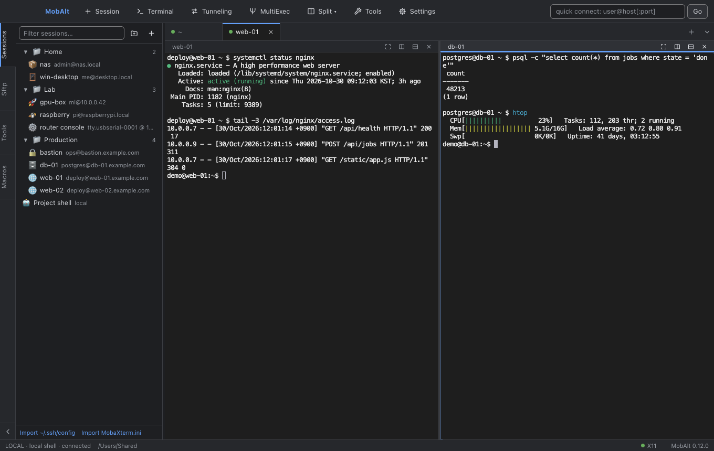
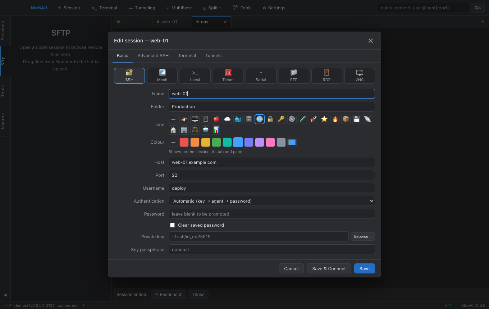
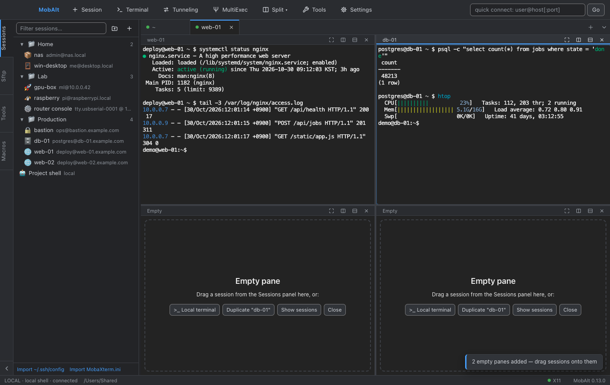
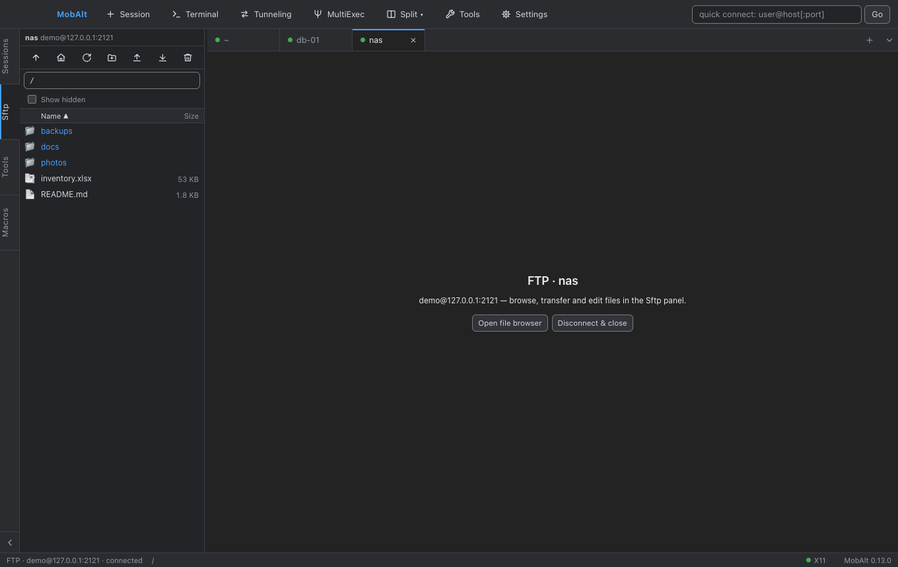
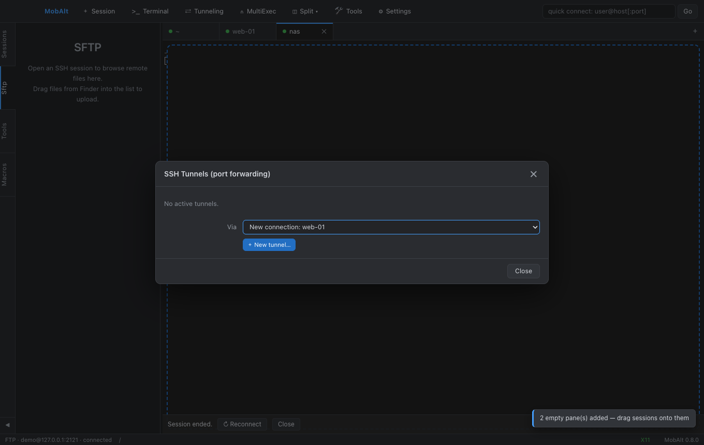
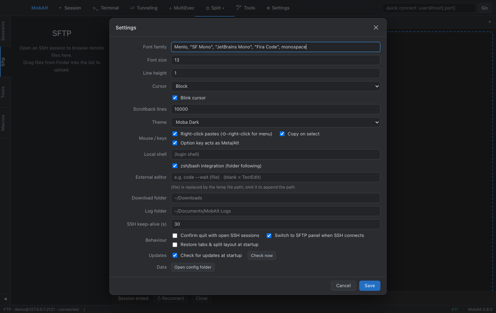

# MobAlt 사용자 안내서

[English guide](USER_GUIDE.md)

MobAlt는 macOS용 MobaXterm 스타일 작업대입니다. 왼쪽에 세션 트리, 가운데에 탭·분할 터미널, 사이드
패널에 SFTP 브라우저·네트워크 도구·매크로가 있습니다.

목차: [설치](#설치) · [업데이트](#업데이트) · [세션](#세션) · [접속](#접속) · [터미널](#터미널) · [파일 (SFTP / FTP)](#파일-sftp--ftp) ·
[터널 (포트 포워딩)](#터널-포트-포워딩) · [X11, Mosh, 시리얼, RDP/VNC](#x11-mosh-시리얼-rdpvnc) ·
[도구와 매크로](#도구와-매크로) · [작업대와 설정](#작업대와-설정) · [단축키](#단축키) ·
[데이터와 개인정보](#데이터와-개인정보) · [문제 해결](#문제-해결)

## 설치

- **Homebrew**: `brew tap Hyeongcheol-An/tap && brew trust Hyeongcheol-An/tap && brew install --cask mobalt`
  (Homebrew 7부터 외부 tap은 한 번 신뢰 처리가 필요하며, 이후 `brew upgrade --cask mobalt`로 업데이트)
- **DMG**: [Releases](https://github.com/Hyeongcheol-An/MobAlt/releases)에서 Apple Silicon(`arm64`) 또는
  Intel(`x64`) DMG를 받아 MobAlt를 Applications로 끌어다 놓습니다.

릴리스는 서명·공증되어 있습니다. macOS 13 이상이 필요합니다. 선택 사항: X11 포워딩용
[XQuartz](https://www.xquartz.org/), Mosh 세션용 `brew install mosh`, RDP용 Windows App.

시작할 때 GitHub Releases에서 새 버전을 확인해 대화상자로 알려 주며, 동의하기 전에는 아무것도
내려받거나 설치하지 않습니다. [업데이트](#업데이트)를 보세요.

## 업데이트

새 버전을 받는 길은 셋이고, 어느 쪽이든 `/Applications/MobAlt.app`이 새 번들로 바뀝니다.

- **앱 내 업데이트**: 시작할 때 GitHub Releases를 확인하고(Settings → Updates에서 끌 수 있음), Help → Check
  for Updates… 또는 Settings → Updates의 "Check now" 버튼으로 직접 확인합니다. 새 버전은 대화상자로 제안되고, 동의할
  때만 내려받아 종료할 때(또는 "Restart now"를 고르면 바로) 설치합니다.
- **Homebrew**: `brew upgrade --cask mobalt`가 Applications의 앱을 교체합니다.
- **DMG**: [Releases](https://github.com/Hyeongcheol-An/MobAlt/releases)에서 새 DMG를 받아 MobAlt를
  Applications로 끌어다 놓아 기존 앱을 바꿉니다.

앱 내 업데이트와 Homebrew는 서로 부딪히지 않습니다. Settings → Updates의 "Check for updates at startup"이
켜져 있으면 MobAlt가 스스로 최신 버전을 유지하고, 그래도 `brew upgrade --cask mobalt`는 언제 실행해도
안전합니다. 앱이 이미 스스로 업데이트했다면 Homebrew는 이미 있는 그 버전을 다시 설치할 뿐입니다. cask가
`auto_updates`를 선언하므로 cask 이름 없이 `brew upgrade`만 실행하면 `--greedy`를 붙이지 않는 한 MobAlt는
건너뜁니다. Homebrew로 업데이트하려면 cask 이름을 적거나 `--greedy`를 붙이세요.

MobAlt가 실행 중인 채로 업그레이드해도 괜찮습니다 — MobAlt의 터미널 안에서 실행해도 마찬가지입니다.
실행 중인 앱은 메모리에 있는 옛 버전을 계속 돌리다가 디스크의 새 번들을 알아차리고(1분 안에, 또는 창에
다시 포커스가 오는 즉시) 탭 위에 배너를 띄웁니다: *MobAlt 0.11.0 is installed on disk — you are running
0.10.1. Relaunch to use it.* **Relaunch**는 ⌘Q처럼 열린 SSH/FTP 연결을 먼저 묻고, 작업대를 저장한 뒤 새
버전으로 다시 시작합니다. 탭은 작업대 복원으로 돌아옵니다. **Later**는 또 다른 버전이 나타날 때까지 배너를
숨깁니다. 업데이트 확인이 돌 때 새 번들이 이미 디스크에 있으면 다시 내려받지 않고 "0.11.0 is already
installed on disk; relaunch to use it"라고 알리며 같은 재시작을 제안합니다.

## 세션

**Sessions** 패널이 즐겨찾기 트리입니다. `＋ Session`(⌘N)으로 세션을 만들고 종류를 고른 뒤 Basic 탭을
채웁니다. 더블클릭하면 접속하고, 우클릭 메뉴에서 열기, 오른쪽/아래 분할로 열기, 편집, 복제, 삭제,
터널 시작, 이 폴더에 새 세션 만들기를 할 수 있습니다.

| 종류 | 설명 |
|---|---|
| SSH | SSH 터미널 + SFTP 브라우저, 터널, X11·에이전트 포워딩 |
| Mosh | `mosh` 클라이언트로 여는 로밍 터미널(SSH로 부트스트랩) |
| Local | macOS 로그인 셸(zsh/bash), 폴더 추종 |
| Telnet | NAWS/TTYPE 협상을 지원하는 텔넷 |
| Serial | USB-시리얼 콘솔(baud, framing, 흐름 제어, 로컬 에코) |
| FTP | FTP / FTPS(명시적 TLS) 파일 브라우저(Sftp 패널) |
| RDP / VNC | Windows App 또는 macOS 화면 공유로 넘김 |

**폴더**: 패널 머리글의 폴더 버튼(New folder)으로 폴더를 만들고, 세션과 폴더를 드래그해 옮깁니다(빈 영역에 놓으면 루트). 폴더
우클릭 메뉴로 안의 세션 전부를 격자나 탭으로 한꺼번에 열 수 있습니다.

**아이콘·색상**: 편집기에서 이모지와 색을 고르면 행·탭·페인 머리글에 표시되어 빨간 "운영" 세션과
초록 "스테이징" 세션을 헷갈리지 않습니다.

**가져오기·내보내기**: 패널 하단에서 `~/.ssh/config`(호스트, 사용자, 포트, 키, ProxyJump)와 MobaXterm의
`MobaXterm.ini`(북마크)를 가져옵니다. 트리 우클릭 메뉴에서 전체 세션을 JSON으로 내보내고 가져올 수
있습니다. JSON 파일에는 모든 세션과 폴더가 들어가지만 비밀번호와 키 암호는 절대 들어가지 않습니다. 그것들은
이 Mac의 암호화된 저장소에만 남고 파일에는 저장돼 있었다는 표시(`hasPassword`)만 남으므로, 다른 Mac에서
가져온 세션은 첫 접속 때 묻습니다. 가져오기는 기존 세션에 합칩니다. `id`가 같은 세션은 파일의 내용으로
바뀌고(여기에 저장된 비밀번호는 유지), 나머지는 추가되며 — `id`가 없는 손으로 쓴 항목은 항상 추가되고, 파일에
직접 적은 `password`는 받아들여 암호화해 저장합니다 — 폴더는 추가되고 아무것도 지워지지 않습니다. 같은 파일을
두 번 가져와도 달라지는 것이 없습니다. 이름이 없거나 모르는 종류이거나 포트가 잘못된 항목은 건너뛰고 토스트에
개수를 알리며, MobAlt 세션 파일이 아니면 이유와 함께 거부합니다. `~/.ssh/config`는 이미 있는 호스트(같은
폴더·이름)를 건너뜁니다. MobaXterm 북마크는 `MobaXterm` 폴더 아래 들어가고, 전에 가져온 북마크(같은 폴더·이름·
호스트)는 제자리에서 갱신됩니다 — 호스트·포트·사용자·X11·압축은 `.ini`를 따르고 저장된 비밀번호, 아이콘, 색,
터널, 직접 지정한 키 경로는 그대로 — 그래서 같은 `.ini`를 두 번 가져와도 달라지는 것이 없습니다.

**시작 명령**(Terminal 탭): 한 줄에 명령 하나씩 적으면 터미널이 준비됐을 때 자동으로 입력됩니다. SSH는
로그인 직후, 로컬 셸은 프롬프트가 뜬 직후입니다. 예: 로컬 세션의 Start folder를 프로젝트 폴더로,
명령을 `claude --resume <id>`로.

## 접속

- **빠른 접속**: 툴바 입력란에 `user@host[:port]`를 넣고 Enter. 접두사로 종류를 고릅니다:
  `ssh://`, `mosh://`, `telnet://`, `ftp://`, `ftps://`, `rdp://`, `vnc://`. 저장된 세션과 일치하면
  그 세션을 사용합니다.
- **인증**: *Automatic*은 지정한 키 → 저장된 비밀번호 → SSH 에이전트 → `~/.ssh`의 기본 키 순으로
  시도한 뒤 프롬프트를 띄웁니다. *Password*, *Private key*, *SSH agent*로 제한할 수 있습니다.
  패스프레이즈가 있는 키는 한 번 묻고, "Save in session"을 켜면 저장합니다.
- **호스트 키**: 첫 접속 때 지문(SHA256·MD5)을 보여 줍니다. 수락하면 저장되고, 키가 바뀌면 크게
  경고하며 조용히 받아들이지 않습니다.
- **점프 호스트**: Advanced SSH → Jump host에서 다른 저장 세션을 bastion으로 지정합니다(ProxyJump).
- **실패했을 때**: 터미널에 원인이 출력됩니다. 예: `authentication failed — server accepts:
  publickey; tried: ~/.ssh/id_ed25519`, 또는 포트에 응답이 없다는 안내. [문제 해결](#문제-해결) 참고.

## 터미널

- **탭**: 세션마다 탭이 열립니다. 드래그로 순서를 바꾸고, 더블클릭으로 이름을 바꾸고, 가운데 클릭으로
  닫습니다. 로컬 탭은 현재 폴더 이름이 제목이 됩니다.
- **분할과 격자**: `Split ▾`(⌘D 오른쪽, ⇧⌘D 아래)로 빈 페인을 만들고, 격자 항목으로 1×2 … 2×4
  배치를 만듭니다(⌥⌘2/4/6/8). 트리의 세션을 빈 페인에 놓으면 거기에 접속, 페인 가장자리에 놓으면
  그 방향으로 분할, 가운데에 놓으면 교체됩니다. 탭을 페인에 끌면 그 터미널이 분할로 옮겨집니다.
  ⌥⌘1은 분할 해제(포커스된 페인 유지)입니다.
- **페인 확대(Zoom)**(⇧⌘⏎, 페인 머리글의 ⤢ 버튼, 또는 `Split ▾` → Zoom Pane): tmux의 zoom이나
  iTerm2의 maximize처럼 포커스된 페인이 탭 전체를 채웁니다. 나머지 페인은 접속을 유지한 채 숨겨지고,
  페인 머리글에 *zoomed* 표시, 탭에 작은 ⤢가 붙습니다. 다시 누르면(머리글의 ⤡) 원래 배치로 돌아옵니다.
  분할, 페인 닫기, 격자 배치, 숨겨진 페인으로 포커스 이동(⌘])은 먼저 배치를 되돌립니다. 확대 상태는
  탭마다 따로 유지되고 재시작 뒤에도 복원됩니다.
- **MultiExec**(⇧⌘M): 켜져 있는 동안 화면에 보이는 모든 터미널, 즉 현재 탭의 살아 있는 페인(페인을
  확대한 동안에는 그 페인 하나)에 같은 입력이 들어갑니다. 다른 탭에는 전달되지 않으므로, 함께 다룰
  서버들은 탭을 분할(또는 그리드)해서 나란히 띄우세요. 배너에 보이는 수신 터미널 수가 표시되고 탭을
  바꾸면 그에 맞춰 바뀝니다.
- **찾기**(⌘F): 대소문자·정규식 토글과 일치 수 표시가 있는 증분 검색.
- **클립보드**: 선택하면 복사(Settings → Terminal → Copy on select), 우클릭은 붙여넣기(⇧+우클릭은 메뉴). Finder
  파일을 SSH 터미널에 놓으면 업로드, 로컬 터미널에 놓으면 경로가 붙여넣어집니다.
- **키**: Shift+Enter와 Option+Enter는 ESC+CR을 보내 Claude Code 같은 TUI에서 줄바꿈이 됩니다.
  Option은 기본적으로 Meta로 동작합니다.
- **로그**: Terminal → Start/Stop Session Log 또는 세션 옵션으로 출력을 `~/Documents/MobAlt Logs/`에
  기록합니다. Settings → Logging의 *Strip colours and control sequences*를 켜면 ANSI 색상·제어
  시퀀스·폴더 추적 훅을 걷어낸 일반 텍스트로 저장합니다.
- **테마·외관**: Settings → Terminal → Theme는 터미널만이 아니라 프로그램 전체의 색을 바꿉니다. 툴바·사이드바·탭·
  상태 표시줄·대화상자·메뉴·토스트·배너가 선택한 팔레트에서 파생된 크롬 색을 쓰고(*Moba Dark*는 익숙한
  어두운 크롬, *Light*는 거의 흰 패널에 어두운 글자의 밝은 앱, *One Dark*·*Dracula*·*Solarized Dark*·
  *Gruvbox Dark*는 각자의 색조로 크롬을 물들임), 네이티브 컨트롤과 타이틀 바 띠도 따라갑니다. 크롬의 모든
  글자색은 어느 테마에서든 배경과 최소 4.5:1 명암비를 유지합니다. 테마 선택 상자 옆에는 그 팔레트 자체의
  색으로 그린 프롬프트 견본이 보이고, Save를 누르면 바로 적용됩니다. Settings → Terminal → Font는 모든 터미널에
  적용되고, 세션별로 Terminal 탭에서 테마·글꼴을 덮어쓸 수 있습니다. 세션 테마는 그 창의 터미널만 바꾸고
  창 전체는 전역 테마를 따릅니다.

## 파일 (SFTP / FTP)

**Sftp** 패널은 활성 SSH 또는 FTP 페인을 따라갑니다. 접속하면 자동으로 열립니다(Settings → General → "Switch
to SFTP panel when SSH connects").

- 폴더 더블클릭, 경로 입력(`~` 가능), ⬆ / 🏠 / ⟳ 버튼으로 이동합니다. "Follow terminal folder"는
  셸의 현재 폴더를 패널이 따라가게 합니다(세션 옵션 필요, 작은 프롬프트 훅을 주입). `>_`는 터미널에
  `cd`를 보냅니다.
- 툴바와 우클릭 메뉴: 새 폴더, 이름 변경, 권한, 삭제, 다운로드, 업로드. ⌘ / ⇧로 여러 개 선택. Finder에서
  목록으로 끌어 업로드하며, 같은 이름이 있으면 덮어쓸지 묻습니다.
- 텍스트 파일을 더블클릭하면 내장 편집기에서 열립니다(⌘S로 저장). "Edit in external editor"는 외부
  편집기(Settings → General → External editor)로 열고 저장할 때마다 다시 업로드합니다.
- 전송 목록에 진행률·속도·취소 버튼이 있고, 다운로드 후 "Show in Finder"를 누를 수 있습니다.
- 열 머리글로 이름·크기·날짜 정렬. 사이드바가 좁으면 날짜 열이 숨겨집니다.

## 터널 (포트 포워딩)

`Tunneling`(⇧⌘U)에서 SSH 포트 포워딩을 관리합니다.

- **Local (-L)**: `127.0.0.1:8080 → db.internal:5432`를 SSH 호스트를 거쳐 연결.
- **Remote (-R)**: 서버의 포트를 로컬 서비스로 되돌림.
- **Dynamic (-D)**: 서버를 거치는 로컬 SOCKS5 프록시.

열린 연결로 터널을 시작하거나, 저장된 세션으로 전용 연결을 열게 할 수 있습니다. 세션의 **Tunnels**
탭에 등록한 터널은 그 세션이 접속할 때 자동으로 시작되며, 바인드에 실패하면 알려 줍니다.

## X11, Mosh, 시리얼, RDP/VNC

- **X11**: Advanced SSH에서 "X11 forwarding"을 켭니다. 필요하면 XQuartz를 띄우고 디스플레이를
  포워딩하며 인증 쿠키를 바꿔치기하므로 `xeyes`나 `gedit`가 바로 뜹니다. 상태 표시줄에 X11 가능 여부가
  보입니다.
- **Mosh**: 로컬에 `brew install mosh`, 호스트에 `mosh-server`(UDP 60000-61000)가 필요합니다. 페인에서
  mosh 클라이언트가 돌고, SSH 부트스트랩은 키·에이전트·대화형 프롬프트를 씁니다. 원격 PATH에 없으면
  `mosh-server` 경로를 지정하세요.
- **Mosh + SFTP**: mosh에는 SFTP 채널이 없으므로 Sftp 패널은 같은 호스트로 셸 없는 별도 SSH 연결을 열어
  파일을 봅니다(키·에이전트·프롬프트는 SSH 세션과 동일). 세션의 "Open SFTP browser automatically"(그리고
  Settings → General의 "Switch to SFTP panel")가 켜져 있으면 자동으로, 아니면 패널의 "Open SFTP for this host (via SSH)"
  버튼이나 페인 메뉴의 "Open SFTP Browser"로 엽니다. 페인을 닫으면 함께 끊깁니다.
- **시리얼**: 편집기가 USB-시리얼 장치를 나열합니다. baud, 데이터/정지 비트, 패리티, 흐름 제어, 로컬
  에코, Enter가 보내는 문자(CR, LF, CRLF)를 설정합니다.
- **RDP / VNC**: `.rdp` 파일을 만들어 Windows App을 열거나 `vnc://`를 화면 공유로 엽니다. 호스트·사용자·
  폴더는 다른 즐겨찾기처럼 보관됩니다.

## 도구와 매크로

- **Tools** 패널: ping, traceroute, DNS 조회, 포트 스캔, 로컬 네트워크 정보. 오래 걸리는 작업은 Stop으로
  중단합니다.
- **Macros** 패널: 터미널에서 키 입력을 녹화(● Rec / ■ Stop)해 이름을 붙여 저장하고, 활성 터미널이나
  모든 터미널에 재생합니다. 텍스트 매크로를 직접 적을 수도 있으며 `\n`, `\x1b[A` 같은 이스케이프를
  지원합니다.

## 작업대와 설정

다음 실행 때 탭·분할·세션을 되살리고 SSH 세션은 자동 재접속합니다(로컬 셸은 마지막 폴더에서 다시
열림). Settings → General → Behaviour에서 끌 수 있습니다.

설정은 네 개의 탭으로 나뉘고 어느 탭이든 최소 창 크기에서 스크롤 없이 들어갑니다. **General**(종료 확인,
SFTP 패널 전환, 작업대 복원, 로컬 셸과 폴더 통합, 외부 편집기, 다운로드 폴더, SSH keep-alive, 저장 위치를
보여 주는 "Open config folder"), **Terminal**(글꼴, 줄 간격, 커서, 스크롤백, 테마(창 전체의 외관, *테마·외관* 참고), 마우스/키), **Logging**(로그
폴더, 일반 텍스트 세션 로그), **Updates**(시작 시 확인과 "Check now").

## 단축키

| 동작 | 키 |
|---|---|
| 새 세션 / 로컬 터미널 / 빠른 접속 | ⌘N / ⌘T / ⇧⌘N |
| 복제 / 재접속 / 탭 닫기 / 페인 닫기 | ⇧⌘T / ⌘R / ⌘W / ⇧⌘W |
| 오른쪽 / 아래 분할, 분할 해제 | ⌘D / ⇧⌘D, ⌥⌘1 |
| 격자 2 / 4 / 6 / 8 페인 | ⌥⌘2 / ⌥⌘4 / ⌥⌘6 / ⌥⌘8 |
| 다음 페인, 다음 / 이전 탭, 1-9번 탭 | ⌘] , ⌃Tab / ⌃⇧Tab, ⌃⌘1-9 |
| 페인 확대(탭 전체) / 배치 복원 | ⇧⌘⏎ |
| 찾기, 지우기, 확대/축소 | ⌘F, ⌘K, ⌘= / ⌘- / ⌘0 |
| 사이드바, Sessions / SFTP / Tools / Macros | ⌘B, ⌘1 / ⌘2 / ⌘3 / ⌘4 |
| MultiExec, 터널, 설정 | ⇧⌘M, ⇧⌘U, ⌘, |
| TUI 앱에서 줄바꿈 | ⇧Enter 또는 ⌥Enter |
| 포커스된 탭: 이동 / 활성화 / 닫기, 컨텍스트 메뉴 | ← → / ⏎ / ⌫, ⇧F10 또는 Menu 키 |
| 포커스된 세션 행: 이동 / 접기·펼치기 / 열기 / 분할로 열기 / 삭제 | ↑ ↓ / ← → / ⏎ / ⌘⏎ 또는 ⇧⏎ / ⌫ |
| 포커스된 세션 행·폴더: 컨텍스트 메뉴 (폴더: Move to Folder…) | ⇧F10 또는 Menu 키 |
| 포커스된 매크로: 이동 / 실행 / 삭제, 컨텍스트 메뉴 | ↑ ↓ / ⏎ / ⌫, ⇧F10 또는 Menu 키 |
| SFTP 목록: 이동 / 열기 / 상위 폴더 / 삭제, 컨텍스트 메뉴 | ↑ ↓ Home End PgUp PgDn / ⏎ / ⌫ / Del, ⇧F10 또는 Menu 키 |
| SFTP 목록: 선택 범위 확장 / 포커스된 행 선택 토글 / 전체 선택 | ⇧↑ ⇧↓ ⇧Home ⇧End / Space / ⌘A |
| SFTP 목록: 열 기준 정렬 | Tab으로 Name / Size / Modified 머리글로 이동, ⏎ 또는 Space |
| 세션 트리와 SFTP 목록: 이름으로 바로 가기 | 이름의 첫 글자 입력, 공백 포함 (같은 글자를 다시 누르면 다음 항목) |
| 세션 편집기의 아이콘·색 선택: 이동 / 선택 | ← → ↑ ↓ / ⏎ 또는 Space |
| 사이드 스트립 패널 버튼 / ⌘1-4 | ⏎로 키보드가 패널 안으로 들어가고, 패널을 바꿔도 있던 자리를 기억합니다 |

Help → Keyboard Shortcuts에서 앱 안에서도 볼 수 있습니다. Tab 키로 툴바, 사이드 스트립, 세션 트리,
매크로 목록, SFTP 목록, 탭 스트립에 차례로 갈 수 있고(목록은 각각 Tab 정지점 하나, 안에서는 화살표로
이동), 대화상자 안에서는 Tab이 밖으로 나가지 않으며 닫힐 때 포커스는 대화상자를 연 탭·행·버튼으로
돌아갑니다. 컨텍스트 메뉴는 ↑ ↓ / ⏎ / Esc로 조작합니다. 세션 필터와 빠른 접속 상자에서 Esc는 내용을
지우고 터미널로 돌아갑니다.

## 데이터와 개인정보

모든 데이터는 `~/Library/Application Support/MobAlt/`에 있습니다: `sessions.json`(비밀번호·패스프레이즈는
macOS Keychain 기반 암호화), `settings.json`, `known_hosts`, `workspace.json`, zsh 통합 파일. 세션 로그는
`~/Documents/MobAlt Logs/`에 저장됩니다. 앱은 사용자가 설정한 호스트에만 접속하며, 선택적인 업데이트
확인은 GitHub의 릴리스 목록만 읽습니다. 자세한 내용: [SECURITY.md](../SECURITY.md).

## 문제 해결

- **"Timed out while waiting for handshake" / ETIMEDOUT**: 그 포트에서 아무 응답이 없습니다. 주소, VPN,
  공유기 포트 포워딩을 확인하고 로컬 터미널에서 `nc -vz host port`를 해 보세요.
- **"authentication failed — server accepts: …; tried: …"**: 서버가 MobAlt가 제시한 방법을 받지
  않았습니다. "accepts" 목록과 세션의 인증 방법을 비교하고, 키 전용 서버라면 알맞은 키 파일을 지정하세요.
  실패가 반복되면 fail2ban이나 sshd의 per-source 패널티로 IP가 잠시 차단될 수 있습니다.
- **호스트 키 변경**: 서버가 재설치됐거나 누군가 연결을 가로채고 있습니다. 이유를 알 때만 수락하고, 옛
  키는 설정 폴더의 `known_hosts`에서 지울 수 있습니다.
- **X11 앱이 안 뜸**: XQuartz를 설치하고, 원격 셸의 시작 파일이 `DISPLAY`를 덮어쓰지 않는지 확인하세요.
- **Mosh**: "mosh client not found"는 로컬에 `brew install mosh`가 없는 것, "mosh-server not found"는
  호스트에 없거나 PATH에 없는 것입니다(세션에 경로 지정).
- **직접 빌드한 앱의 Gatekeeper 경고**: 한 번 우클릭 → 열기, 또는
  `xattr -dr com.apple.quarantine /Applications/MobAlt.app`.
- **`brew upgrade --cask mobalt`에서 `hdiutil: attach failed – Resource busy`**: 그 순간 다른 Homebrew
  프로세스(예: `brew audit`, `brew fetch`)가 같은 DMG를 마운트하고 있던 것입니다. 명령을 다시 실행하면 됩니다.
